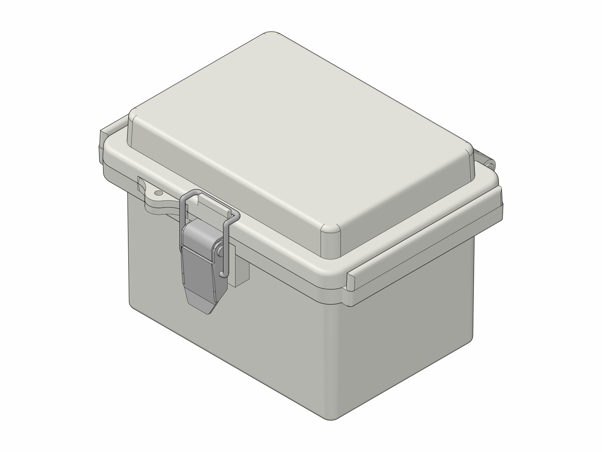

# BCAP091208

[English](README.md) | 日本語

## STEP ファイル

| 型番 | 色 | ファイル |
|---|---|---|
| BCAP091208G | ホワイトグレー | [BCAP091208G.step](BCAP091208G.step) |
| BCAP091208T | 透明カバー | [BCAP091208T.step](BCAP091208T.step) |

## 外形寸法

| mm | W (Y) | D (X) | H (Z) |
|---|---|---|---|
| カタログ | 90 | 120 | 85 |
| 耳・蝶番・ラッチ・脚を含む全体 | 106.25 | 128.4 | 87 |

注記: [NOTICE.ja.md](../../../NOTICE.ja.md) · ライセンス: [CC BY 4.0](../../../LICENSE)
