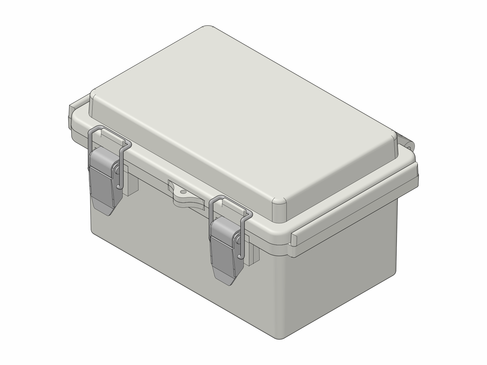

# BCAP101508

[English](README.md) | 日本語

## STEP ファイル

| 型番 | 色 | ファイル |
|---|---|---|
| BCAP101508G | ホワイトグレー | [BCAP101508G.step](BCAP101508G.step) |
| BCAP101508T | 透明カバー | [BCAP101508T.step](BCAP101508T.step) |

## 外形寸法

| mm | W (Y) | D (X) | H (Z) |
|---|---|---|---|
| カタログ | 100 | 150 | 85 |
| 耳・蝶番・ラッチ・脚を含む全体 | 117.25 | 158.4 | 87 |

注記: [NOTICE.ja.md](../../../NOTICE.ja.md) · ライセンス: [CC BY 4.0](../../../LICENSE)
