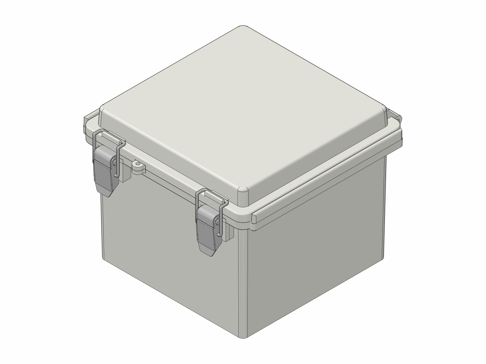

# BCAP151512

[English](README.md) | 日本語

## STEP ファイル

| 型番 | 色 | ファイル |
|---|---|---|
| BCAP151512G | ホワイトグレー | [BCAP151512G.step](BCAP151512G.step) |
| BCAP151512T | 透明カバー | [BCAP151512T.step](BCAP151512T.step) |

## 外形寸法

| mm | W (Y) | D (X) | H (Z) |
|---|---|---|---|
| カタログ | 150 | 150 | 120.5 |
| 耳・蝶番・ラッチ・脚を含む全体 | 166.75 | 158.4 | 121.5 |

注記: [NOTICE.ja.md](../../../NOTICE.ja.md) · ライセンス: [CC BY 4.0](../../../LICENSE)
