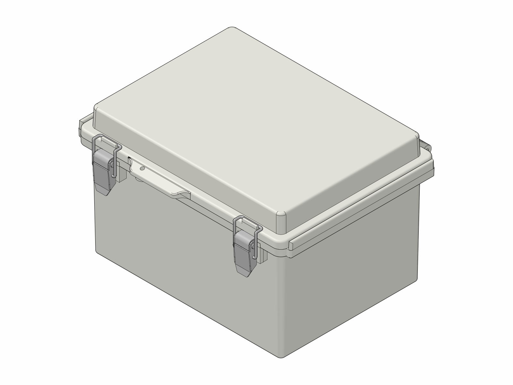

# BCAP162113

[English](README.md) | 日本語

## STEP ファイル

| 型番 | 色 | ファイル |
|---|---|---|
| BCAP162113G | ホワイトグレー | [BCAP162113G.step](BCAP162113G.step) |
| BCAP162113T | 透明カバー | [BCAP162113T.step](BCAP162113T.step) |

## 外形寸法

| mm | W (Y) | D (X) | H (Z) |
|---|---|---|---|
| カタログ | 160 | 210 | 130 |
| 耳・蝶番・ラッチ・脚を含む全体 | 177.5 | 218.4 | 131 |

注記: [NOTICE.ja.md](../../../NOTICE.ja.md) · ライセンス: [CC BY 4.0](../../../LICENSE)
